# Stochastic Processes in Finance

An academic study comparing geometric random walk, geometric Brownian motion,
and log-space Ornstein-Uhlenbeck simulations with **AAPL** and the **VIX
volatility index**.

**[Read the full research report (PDF)](results/report.pdf)**

<!-- REPORT-PAGES:START -->

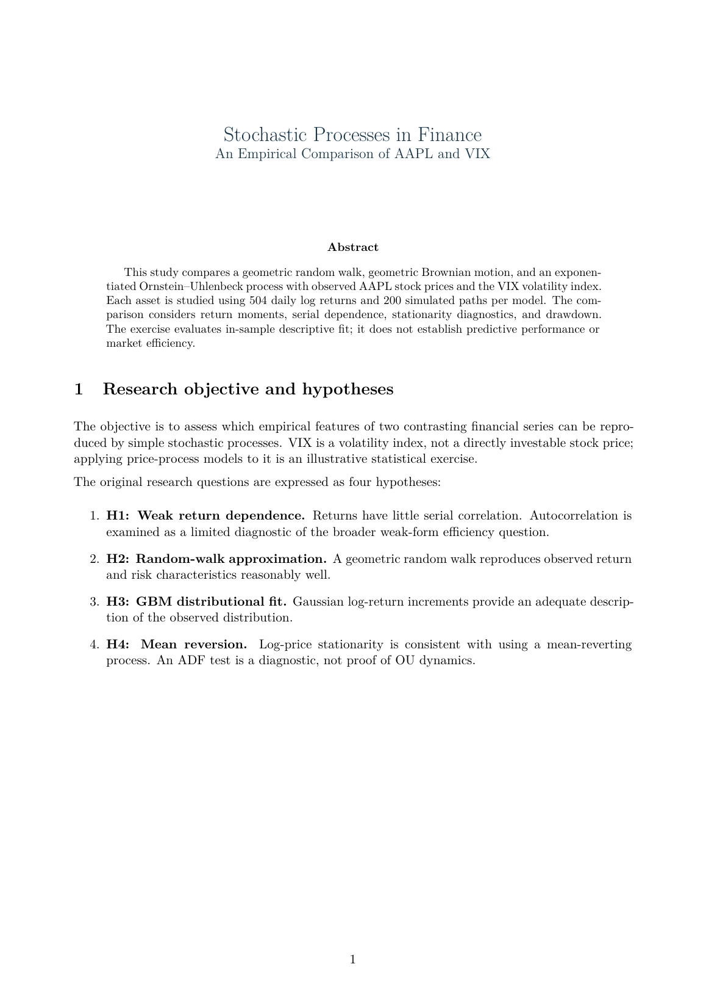

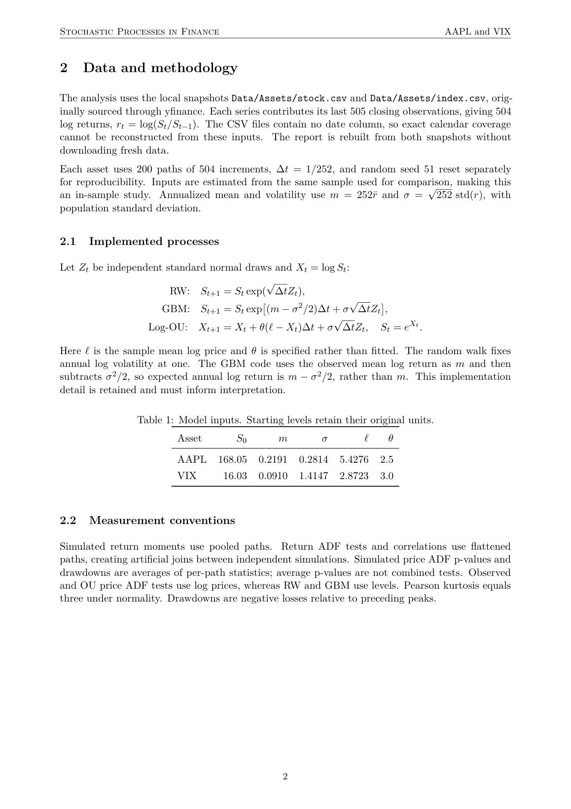

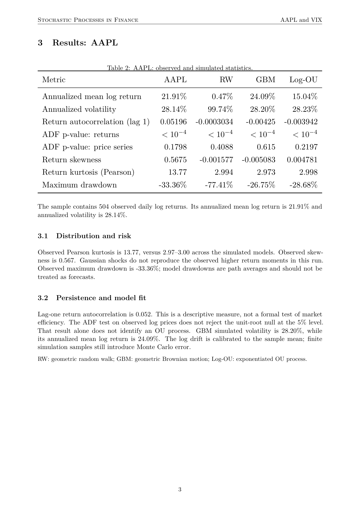

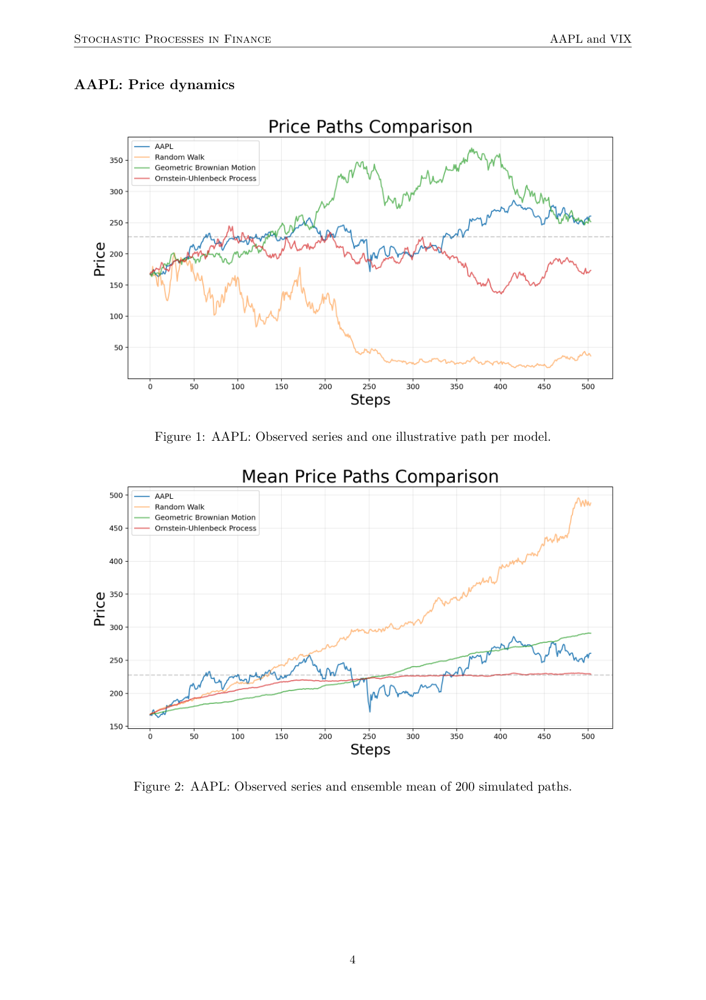

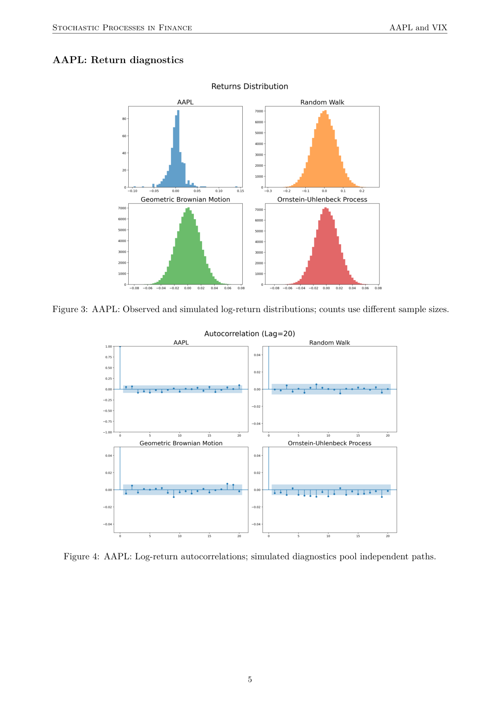

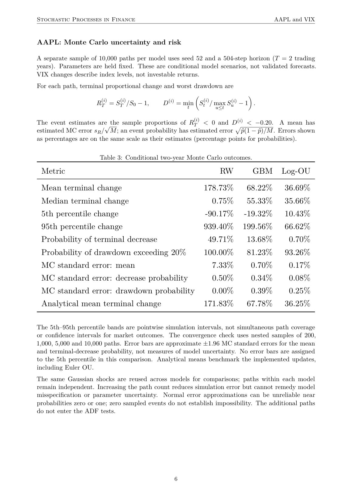

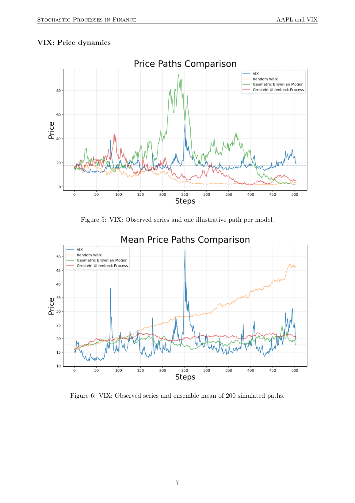


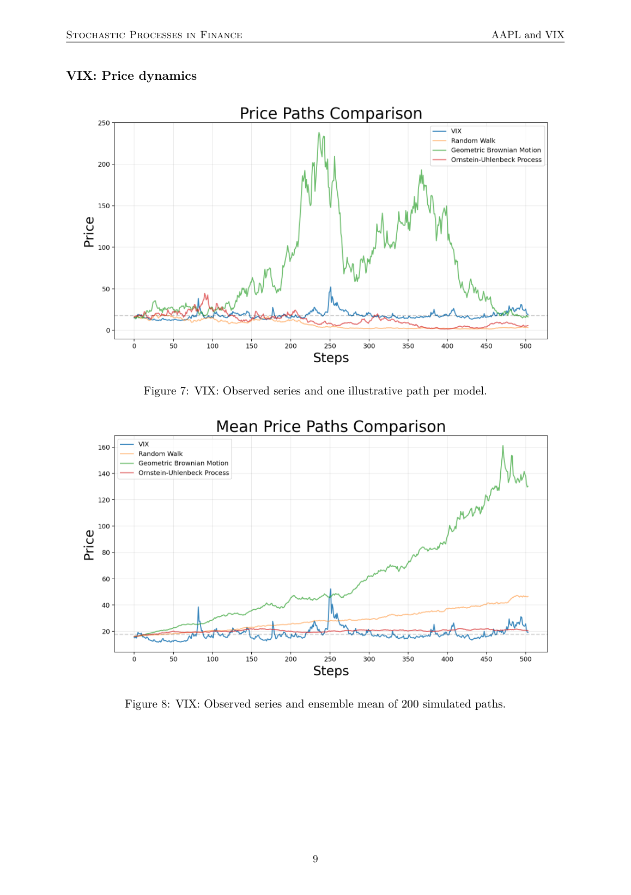


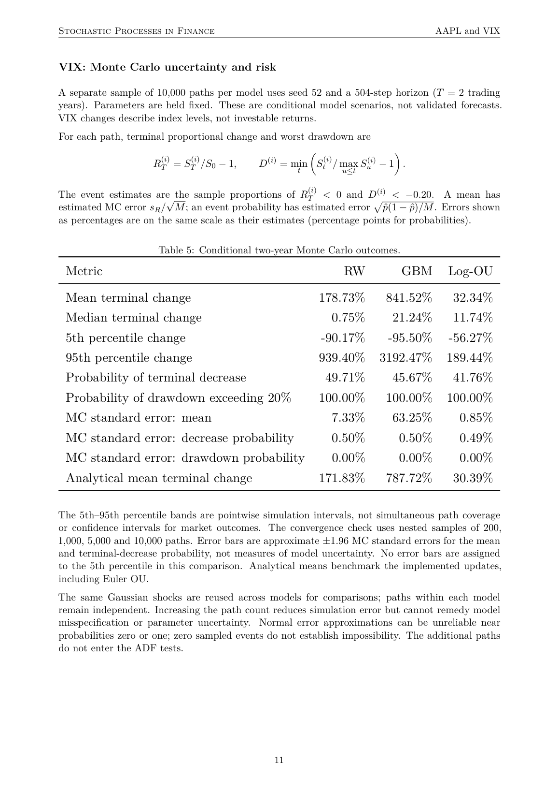

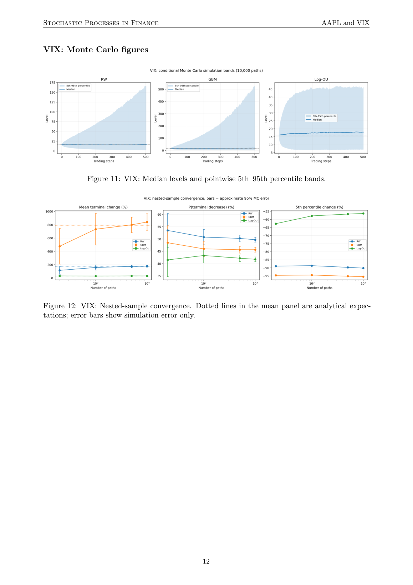

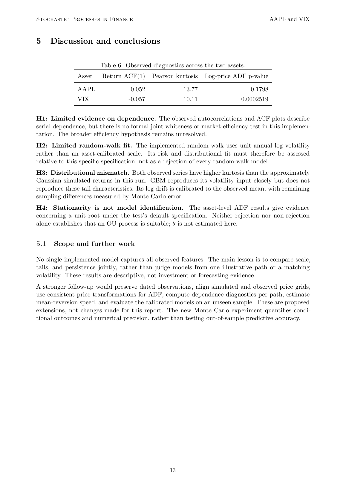

<!-- REPORT-PAGES:END -->

## Run the analysis

```bash
pip install -r requirements.txt
python src/analysis.py
```

The script uses the local datasets in `Data/Assets`, analyzes both assets,
and regenerates the report. PDF generation requires Tectonic or pdfLaTeX;
the local portable compiler is excluded from Git.

Model definitions are in `src/simulations.py`; statistical measures are in
`src/metrics.py`.
